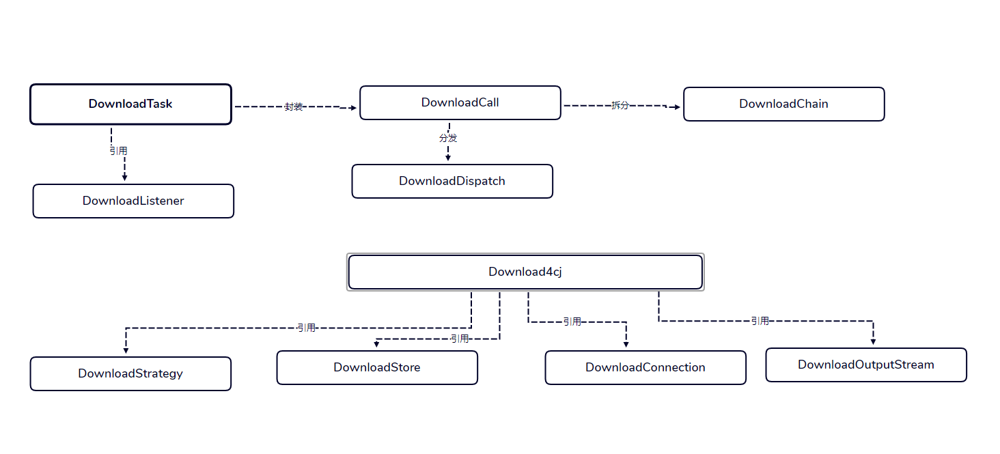
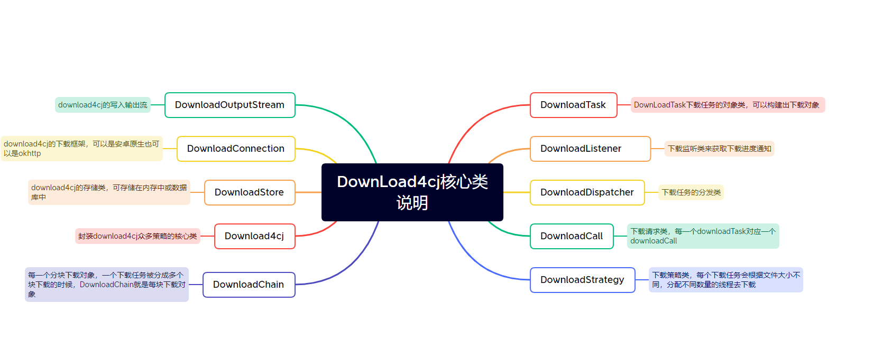
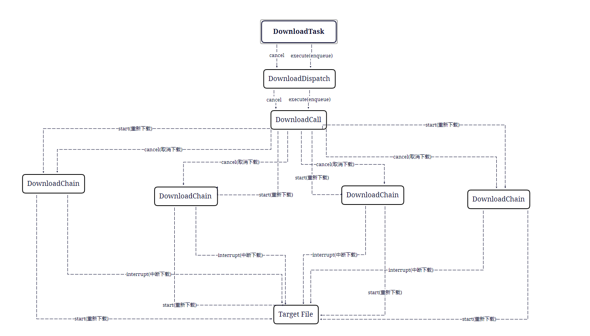

<div align="center">
<h1>DownLoad4cj</h1>
</div>


<p align="center">


</p>


##  介绍
可靠、灵活、快速和强大的下载引擎。提供同步下载,异步下载,暂停任务
参考地址 https://github.com/lingochamp/okdownload.git

### 特性

- 🚀 支持多线程下载

- 🚀 纯仓颉开发，无额外引用

- 🚀 支持同步下载和异步下载

- 🚀 支持暂停任务

##  软件架构

### 架构图

<p align="center">



</p>


### 源码目录
```shell
.
├── CHANGELOG.md
├── gitee_gate.cfg
├── LICENSE
├── module.json
├── README.md
├── README.OPENSOURCE
├── doc
│  ├── assets
│  └── feaure_api.md
├── src
│  ├── BreakpointInterceptor.cj
│  ├── BreakPointLocalCheck.cj
│  ├── BreakPointLocalCheck.cj
│  ├── ......cj
│  ├── DownloadTask.cj
│  ├── DownloadCall.cj
│  ├── DownloadChain.cj
│  ├── DownloadListener.cj
│  ├── DownloadDispatcher.cj
│  ├── DownloadStrategy.cj
│  ├── Download4cj.cj
│  ├── DownloadStore.cj
│  ├── DownloadOutputStream.cj
│  └── DownloadConnection.cj
└── test
```
- `doc`  包含库的图片资源，feature_api文档
- `src`  download4cj项目的源码目录
- `test` 示例代码目录，里面存放了测试用例

### 接口说明

主要是核心类和成员函数说明，详情请见  [设计文档](./doc/feature_api.md)

##  使用说明

### 编译

#### Linux编译

```
git clone https://gitee.com/HW-PLLab/download4cj.git
地址：https://gitee.com/HW-PLLab/testJekins 将 src 下 ci_test 放入 download4cj 根目录下
python3 ci_test/main.py build
```

#### Windows编译

```
1.获取最新tag的download4cj代码
2.配置依赖库
  (1)在src同级目录下创建okhttp文档，根据download4cj/module.json文件中指定的okhttp版本获取okhttp代码
  (2)根据okhttp库介绍编译okhttp库
3.编译download4cj
  (1)切换到download4cj下，即src同级目录，执行如下命令，提示success即表示编译成功
     cpm build
```


### 功能示例

####  同步下载示例

```

import download4cj.*
import std.collection.*
import std.fs.*

var isComplete = false

main(){

        var url:String = "http://imgsrc.baidu.com/forum/w%3D580/sign=eed1753686d6277fe9123230183a1f63/9dcd7cd98d1001e950d1f582b90e7bec55e7974b.jpg"
        let parentFilePath:Path = Path("./fileDownLoad")
        var parentFile:Option<Directory> = Option<Directory>.None
        if (!Directory.exists(parentFilePath)) {
            parentFile = Directory.create(parentFilePath, recursive: true)
        }
        let task:DownloadTask = DownloadTaskBuilder(url, parentFile.getOrThrow())
            .setMinIntervalMillisCallbackProcess(30)
            .build()
        task.execute(MyListen())
        if(isComplete){
            println(isComplete)
            return 0
        }else{
            return 1
        }

}

public class MyListen<: DownloadListener{

    public func taskStart(task:DownloadTask):Unit{
    }

    public func connectTrialStart(task:DownloadTask,requestHeaderFields:HashMap<String, ArrayList<String>>):Unit{
    }

    public func connectTrialEnd(task:DownloadTask,responseCode:Int64,responseHeaderFields:HashMap<String, ArrayList<String>>):Unit{
    }

    public func downloadFromBeginning(task:DownloadTask):Unit{
    }

    public func downloadFromBreakpoint(task:DownloadTask):Unit{
    }

    public func connectStart(task:DownloadTask,blockIndex:Int64,requestHeaderFields:HashMap<String, ArrayList<String>>):Unit{
    }

    public func connectEnd(task:DownloadTask,blockIndex:Int64,responseCode:Int64,requestHeaderFields:HashMap<String, ArrayList<String>>):Unit{
    }

    public func fetchStart(task:DownloadTask,blockIndex:Int64,contentLength:Int64):Unit{
    }

    public func fetchProgress(task:DownloadTask,blockIndex:Int64,increaseBytes:Int64):Unit{
    }

    public func fetchEnd(task:DownloadTask,blockIndex:Int64,contentLength:Int64):Unit{
    }

    public func taskEnd(task:DownloadTask,realCause:Option<Exception>):Unit{
        isComplete = true
    }
}
```

执行结果如下：

```shell

true

```

####  异步下载示例

```

import download4cj.*
import std.collection.*
import std.fs.*

var isComplete = false

main(){

    var url:String = "http://imgsrc.baidu.com/forum/w%3D580/sign=eed1753686d6277fe9123230183a1f63/9dcd7cd98d1001e950d1f582b90e7bec55e7974b.jpg"
    let lastIndex:Int64 = url.lastIndexOf(".").getOrThrow()
    var FileEnds = url.substring(lastIndex)
    let filenamePre:String = "single-test"
    let filename = filenamePre+FileEnds
    let parentFilePath:Path = Path("./fileDownLoad0")
    var parentFile:Option<Directory> = Option<Directory>.None
    if (!Directory.exists(parentFilePath)) {
        parentFile = Directory.create(parentFilePath, recursive: true)
    }
    let task:DownloadTask = DownloadTaskBuilder(url, parentFile.getOrThrow())
         .setFilename(filename)
         .setMinIntervalMillisCallbackProcess(30)
         .build()
     task.enqueue(MyListen())
     sleep(1000*1000*1000*3)
     if(isComplete){
        println(isComplete)
        return 0
     }else{
        return 1
     }
}


public class MyListen<: DownloadListener{

    public func taskStart(task:DownloadTask):Unit{
    }

    public func connectTrialStart(task:DownloadTask,requestHeaderFields:HashMap<String, ArrayList<String>>):Unit{
    }

    public func connectTrialEnd(task:DownloadTask,responseCode:Int64,responseHeaderFields:HashMap<String, ArrayList<String>>):Unit{
    }

    public func downloadFromBeginning(task:DownloadTask):Unit{
    }

    public func downloadFromBreakpoint(task:DownloadTask):Unit{
    }

    public func connectStart(task:DownloadTask,blockIndex:Int64,requestHeaderFields:HashMap<String, ArrayList<String>>):Unit{
    }

    public func connectEnd(task:DownloadTask,blockIndex:Int64,responseCode:Int64,requestHeaderFields:HashMap<String, ArrayList<String>>):Unit{
    }

    public func fetchStart(task:DownloadTask,blockIndex:Int64,contentLength:Int64):Unit{
    }

    public func fetchProgress(task:DownloadTask,blockIndex:Int64,increaseBytes:Int64):Unit{
    }

    public func fetchEnd(task:DownloadTask,blockIndex:Int64,contentLength:Int64):Unit{
    }

    public func taskEnd(task:DownloadTask,realCause:Option<Exception>):Unit{
        isComplete = true
    }
}

```


执行结果如下：

```shell

true

```


#### 同步下载暂停下载示例

```cangjie

import download4cj.*
import std.collection.*
import std.fs.*

var isComplete = false

main(){

        var url:String = "https://cdn.llscdn.com/yy/files/xs8qmxn8-lls-LLS-5.8-800-20171207-111607.apk"


        let filename:String = "single-test"

        let parentFilePath:Path = Path("./fileDownLoad")
        var parentFile:Option<Directory> = Option<Directory>.None

        if (!Directory.exists(parentFilePath)) {
            parentFile = Directory.create(parentFilePath, recursive: true)
        }else{
        }

        let task:DownloadTask = DownloadTaskBuilder(url, parentFile.getOrThrow())
            .setMinIntervalMillisCallbackProcess(30)
            .build()

        spawn { =>
            sleep(1000*1000*1000)
            task.cancel()
            let blockList:ArrayList<BlockInfo> = task.getBlockInfoList().getOrThrow()
            for(oneitem in blockList){
                println("==========================================================")
                println("blockinfoCurrent="+oneitem.getCurrentOffset().toString()+"=========blockinfoContent="+oneitem.getContentLength().toString())
                println("blockinfoRangeLeft="+oneitem.getRangeLeft().toString()+"=========blockinfoRangeRight="+oneitem.getRangeRight().toString())
                println("==========================================================")
            }
        }

        task.execute(MyListen())


        sleep(1000*1000*1000*3)
        task.execute(MyListen())
        sleep(1000*1000*1000*3)

        if(isComplete && task.getConnectionCount()==3){
            println(true)
            return 0
        }else{
            println(false)
            return 1
        }


}

public class MyListen<: DownloadListener{

    public func taskStart(task:DownloadTask):Unit{
    }

    public func connectTrialStart(task:DownloadTask,requestHeaderFields:HashMap<String, ArrayList<String>>):Unit{
    }

    public func connectTrialEnd(task:DownloadTask,responseCode:Int64,responseHeaderFields:HashMap<String, ArrayList<String>>):Unit{
    }

    public func downloadFromBeginning(task:DownloadTask):Unit{
    }

    public func downloadFromBreakpoint(task:DownloadTask):Unit{
    }

    public func connectStart(task:DownloadTask,blockIndex:Int64,requestHeaderFields:HashMap<String, ArrayList<String>>):Unit{
    }

    public func connectEnd(task:DownloadTask,blockIndex:Int64,responseCode:Int64,requestHeaderFields:HashMap<String, ArrayList<String>>):Unit{
    }

    public func fetchStart(task:DownloadTask,blockIndex:Int64,contentLength:Int64):Unit{
    }

    public func fetchProgress(task:DownloadTask,blockIndex:Int64,increaseBytes:Int64):Unit{
    }

    public func fetchEnd(task:DownloadTask,blockIndex:Int64,contentLength:Int64):Unit{
    }

    public func taskEnd(task:DownloadTask,realCause:Option<Exception>):Unit{
        isComplete = true
    }
}


```

执行结果如下：

```shell

true

```


#### 异步下载暂停下载示例


```cangjie

import download4cj.*
import std.collection.*
import std.fs.*

var isComplete = false

main(){

        var url:String = "https://cdn.llscdn.com/yy/files/xs8qmxn8-lls-LLS-5.8-800-20171207-111607.apk"


        let filename:String = "single-test"

        let parentFilePath:Path = Path("./fileDownLoad")
        var parentFile:Option<Directory> = Option<Directory>.None

        if (!Directory.exists(parentFilePath)) {
            parentFile = Directory.create(parentFilePath, recursive: true)
        }else{
        }

        let task:DownloadTask = DownloadTaskBuilder(url, parentFile.getOrThrow())
            .setMinIntervalMillisCallbackProcess(30)
            .build()
        task.enqueue(MyListen())
        sleep(1000*1000*1000)
        task.cancel()

        let blockList:ArrayList<BlockInfo> = task.getBlockInfoList().getOrThrow()
        for(oneitem in blockList){
            println("==========================================================")
            println("blockinfoCurrent="+oneitem.getCurrentOffset().toString()+"=========blockinfoContent="+oneitem.getContentLength().toString())
            println("blockinfoRangeLeft="+oneitem.getRangeLeft().toString()+"=========blockinfoRangeRight="+oneitem.getRangeRight().toString())
            println("==========================================================")
        }

        sleep(1000*1000*1000*2)
        task.enqueue(MyListen())
        sleep(1000*1000*1000*3)
        if(isComplete && task.getConnectionCount()==3){
            println(true)
            return 0
        }else{
            println(false)
            return 1
        }


}

public class MyListen<: DownloadListener{

    public func taskStart(task:DownloadTask):Unit{
    }

    public func connectTrialStart(task:DownloadTask,requestHeaderFields:HashMap<String, ArrayList<String>>):Unit{
    }

    public func connectTrialEnd(task:DownloadTask,responseCode:Int64,responseHeaderFields:HashMap<String, ArrayList<String>>):Unit{
    }

    public func downloadFromBeginning(task:DownloadTask):Unit{
    }

    public func downloadFromBreakpoint(task:DownloadTask):Unit{
    }

    public func connectStart(task:DownloadTask,blockIndex:Int64,requestHeaderFields:HashMap<String, ArrayList<String>>):Unit{
    }

    public func connectEnd(task:DownloadTask,blockIndex:Int64,responseCode:Int64,requestHeaderFields:HashMap<String, ArrayList<String>>):Unit{
    }

    public func fetchStart(task:DownloadTask,blockIndex:Int64,contentLength:Int64):Unit{
    }

    public func fetchProgress(task:DownloadTask,blockIndex:Int64,increaseBytes:Int64):Unit{
    }

    public func fetchEnd(task:DownloadTask,blockIndex:Int64,contentLength:Int64):Unit{
    }

    public func taskEnd(task:DownloadTask,realCause:Option<Exception>):Unit{
        isComplete = true
    }
}


```

执行结果如下：

```shell

true

```


####  异步下载多个文件暂停下载示例

```cangjie

import download4cj.*
import std.collection.*
import std.fs.*

var isComplete = false

main(){


    var url1:String = "http://imgsrc.baidu.com/forum/w%3D580/sign=eed1753686d6277fe9123230183a1f63/9dcd7cd98d1001e950d1f582b90e7bec55e7974b.jpg"
    var url2:String = "http://a2.dxiazaicc.com/down4/win7sp2_downcc.com.zip"
    var url3:String = "https://cr8.197946.com/lenovobatterysetting.zip"


    let lastIndex1:Int64 = url1.lastIndexOf(".").getOrThrow()
    let lastIndex2:Int64 = url2.lastIndexOf(".").getOrThrow()
    let lastIndex3:Int64 = url3.lastIndexOf(".").getOrThrow()
    var FileEnds1 = url1.substring(lastIndex1)
    var FileEnds2 = url2.substring(lastIndex2)
    var FileEnds3 = url3.substring(lastIndex3)


    let filenamePre:String = "single-test"
    let filename1 = filenamePre+"111"+FileEnds1
    let filename2 = filenamePre+"222"+FileEnds2
    let filename3 = filenamePre+"333"+FileEnds3


    let parentFilePath:Path = Path("./fileDownLoad0")
    var parentFile:Option<Directory> = Option<Directory>.None

    if (!Directory.exists(parentFilePath)) {
        parentFile = Directory.create(parentFilePath, recursive: true)
    }else{
    }

    let task1:DownloadTask = DownloadTaskBuilder(url1, parentFile.getOrThrow())
         .setFilename(filename1)
         .setMinIntervalMillisCallbackProcess(30)
         .build()

    let task2:DownloadTask = DownloadTaskBuilder(url2, parentFile.getOrThrow())
         .setFilename(filename2)
         .setMinIntervalMillisCallbackProcess(30)
         .build()

    let task3:DownloadTask = DownloadTaskBuilder(url3, parentFile.getOrThrow())
         .setFilename(filename3)
         .setMinIntervalMillisCallbackProcess(30)
         .build()


    let tasklists:ArrayList<DownloadTask> = ArrayList<DownloadTask>()
    tasklists.append(task1)
    tasklists.append(task2)
    tasklists.append(task3)
    let tasks:Array<DownloadTask> = Array<DownloadTask>(tasklists)


     DownloadTask.enqueues(tasks,MyListen())
     sleep(1000*1000*1000*2)
     DownloadTask.cancels(tasks)

     for(oneTask in tasks){
        println("==========================================================")
        let blockList:ArrayList<BlockInfo> = oneTask.getBlockInfoList().getOrThrow()
        for(oneitem in blockList){
            println("blockinfoCurrent="+oneitem.getCurrentOffset().toString()+"=========blockinfoContent="+oneitem.getContentLength().toString())
            println("blockinfoRangeLeft="+oneitem.getRangeLeft().toString()+"=========blockinfoRangeRight="+oneitem.getRangeRight().toString())
        }
        println("==========================================================")
     }

     sleep(1000*1000*1000*2)
     DownloadTask.enqueues(tasks,MyListen())
     sleep(1000*1000*1000*30)
     if(isComplete){
        println(true)
        return 0
     }else{
        println(false)
        return 1
     }
}


public class MyListen<: DownloadListener{

    public func taskStart(task:DownloadTask):Unit{
    }

    public func connectTrialStart(task:DownloadTask,requestHeaderFields:HashMap<String, ArrayList<String>>):Unit{
    }

    public func connectTrialEnd(task:DownloadTask,responseCode:Int64,responseHeaderFields:HashMap<String, ArrayList<String>>):Unit{

    }

    public func downloadFromBeginning(task:DownloadTask):Unit{
    }

    public func downloadFromBreakpoint(task:DownloadTask):Unit{
    }

    public func connectStart(task:DownloadTask,blockIndex:Int64,requestHeaderFields:HashMap<String, ArrayList<String>>):Unit{
    }

    public func connectEnd(task:DownloadTask,blockIndex:Int64,responseCode:Int64,requestHeaderFields:HashMap<String, ArrayList<String>>):Unit{
    }

    public func fetchStart(task:DownloadTask,blockIndex:Int64,contentLength:Int64):Unit{
    }

    public func fetchProgress(task:DownloadTask,blockIndex:Int64,increaseBytes:Int64):Unit{
    }

    public func fetchEnd(task:DownloadTask,blockIndex:Int64,contentLength:Int64):Unit{
    }

    public func taskEnd(task:DownloadTask,realCause:Option<Exception>):Unit{
       isComplete = true
    }
}

```

执行结果如下：

```shell

true

```

## 开源协议

本项目基于 [Apache License 2.0](./LICENSE) ，请自由的享受和参与开源。


##  参与贡献

欢迎给我们提交PR，欢迎给我们提交Issue，欢迎参与任何形式的贡献。

