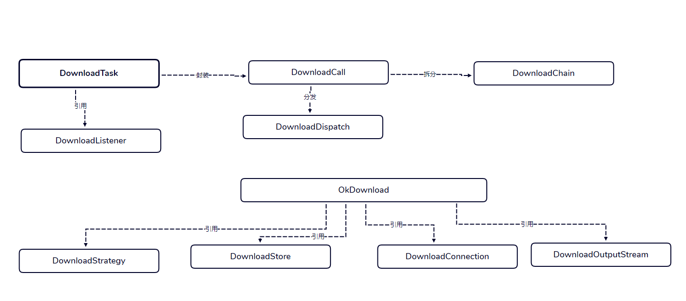
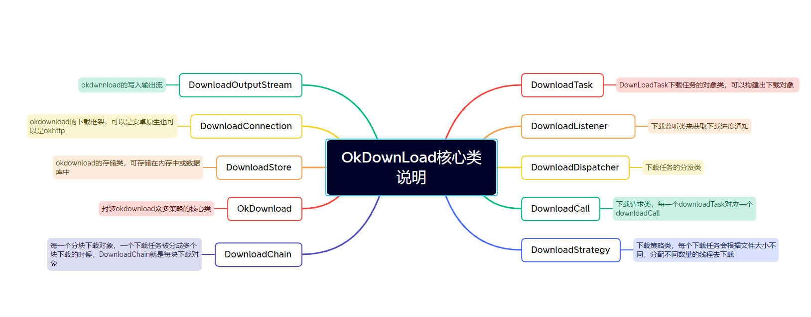

<p align="center">
<h1>OkDownLoad</h1>
</p>


<p align="center">


</p>

# 一个用仓颉实现的okdownload库


##  介绍
可靠、灵活、快速和强大的下载引擎。0.0.1版本提供同步下载  0.0.2提供异步下载 参考地址 https://github.com/lingochamp/okdownload.git

### 特性

- 🚀 支持多线程下载

- 🚀 纯仓颉开发，无额外引用

- 💪 代码简单、精简，可方便学习仓颉和扩展需要的功能


### 架构图

<p align="center">


</p>


### 源码目录
```shell
.
├── README.md
├── doc
├── module.json
├── src
│  ├── DownloadTask.cj
│  ├── DownloadCall.cj
│  ├── DownloadChain.cj
│  ├── DownloadListener.cj
│  ├── DownloadDispatcher.cj
│  ├── DownloadStrategy.cj
│  ├── OkDownload.cj
│  ├── DownloadStore.cj
│  ├── DownloadOutputStream.cj
│  └── DownloadConnection.cj
└── test
```
- `doc` 文档资源目录
- `src` okdownload项目源码目录
- `test` 示例代码目录

### 接口说明

主要是核心类和成员函数说明，详情请见  [设计文档](./doc/design.md)

#### class DownloadTask  DownLoadTask下载任务的对象类，可以构建出下载对象

#####  func execute

用于执行同步下载

```cangjie
public func execute(listener:DownloadListener):Unit
```

#####  func enqueue

用于执行异步下载

```cangjie
public func enqueue(listener:DownloadListener):Unit
```


#####  func enqueues

用于执行异步下载多个

```cangjie
public static func enqueues(tasks:Array<DownloadTask>,listener:DownloadListener):Unit
```


#### class DownloadTaskBuilder   DownloadTaskBuilder下载任务类的构建类对象

##### func setMinIntervalMillisCallbackProcess

设置进度回调的时间间隔

```cangjie
public func setMinIntervalMillisCallbackProcess(minIntervalMillisCallbackProcess:Int64):DownloadTaskBuilder
```

##### func setFilename

设置任务的文件名

```cangjie
 public func setFilename(filename:String):DownloadTaskBuilder
```

##### func setPassIfAlreadyCompleted

设置下载完成后是否要重新下载

```cangjie
 public func setPassIfAlreadyCompleted(passIfAlreadyCompleted:Bool):DownloadTaskBuilder{
```


#### interface DownloadListener  DownLoadTask下载任务的回调监听接口

#####  func taskStart

任务开始的回调

```cangjie
func taskStart(task:DownloadTask):Unit
```

......


任务结束的回调

```cangjie
func taskEnd(task:DownloadTask,cause:EndCause,realCause:Option<Exception>):Unit
```


##  编译执行

### 编译

编译描述和具体shell命令

```shell
cpm update
cpm build
```

### 调用示例
- 示例代码1
```
// EXEC: cjc %import-path %L %l %f
// EXEC: ./main


from okdownload import okdownload.*
from std import collection.*
from std import fs.*

main(){

    var url:String = "https://cdn.llscdn.com/yy/files/xs8qmxn8-lls-LLS-5.8-800-20171207-111607.apk"
    let lastIndex:Int64 = url.lastIndexOf(".").getOrThrow()
    var FileEnds = url.substring(lastIndex)
    //println("FileEnds="+FileEnds)

    let filenamePre:String = "single-test"
    let filename = filenamePre+FileEnds

    let parentFilePath:Path = Path("./fileDownLoad0")
    var parentFile:Option<Directory> = Option<Directory>.None

    if (!Directory.exists(parentFilePath)) {
        parentFile = Directory.create(parentFilePath, recursive: true)
    }else{
    }

    //let parentFile:File = File(parentFilePath,OpenOption.Create(true))
    let task:DownloadTask = DownloadTaskBuilder(url, parentFile.getOrThrow())
         .setFilename(filename)
         // the minimal interval millisecond for callback progress
         .setMinIntervalMillisCallbackProcess(30)
         .setPassIfAlreadyCompleted(false)
         .build()

     task.execute(DefaultTransmitListener())
     //task.enqueue(DefaultTransmitListener())

}
```


##  参与贡献

欢迎给我们提交PR，欢迎给我们提交Issue，欢迎参与任何形式的贡献。

